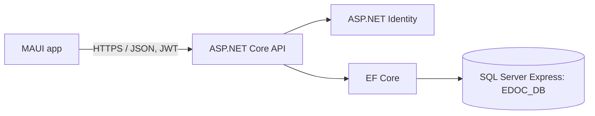

# E-DOC Healthcare App

Cross-platform healthcare appointment starter built with .NET 10, .NET MAUI, ASP.NET Core, ASP.NET Identity, EF Core, and SQL Server Express. The checked-in implementation focuses on a real registration → doctor search → slot lookup → booking → appointment history path. It is a development foundation, not a finished clinical product.

## Current implementation status

Implemented in source: patient registration/login with Identity password hashing and JWTs; Identity roles; doctor/facility search; administrator doctor, schedule, facility and role provisioning endpoints; UTC slot lookup; serializable appointment booking with availability recheck, idempotency keys, overlap checks, audit events and notifications; patient-owned appointment history/medical record/measurement reads; validated measurement writes; cancellation/status rules; global safe API errors; Swagger in Development; MAUI login/registration, directory, availability, booking, history, emergency information placeholder; Android and Windows targets; SQL Server migration.

Verified here: SQL Server Express connectivity using Windows Authentication; creation and migration of the empty `EDOC_DB`; 22 tables, 12 foreign keys, and one applied migration; API build; Windows and Android MAUI Debug builds; four unit tests; API health, Swagger, doctor search, and unauthenticated access checks. NuGet's vulnerability audit reported no vulnerable API packages after dependency updates. Booking was not exercised end-to-end against a provisioned doctor and schedule.

Not implemented yet: the full 50-screen feature list, staff/medical-note workflows, complete profile editing, password reset/email verification/refresh tokens, rescheduling, complete hospital/department/specialty CRUD, notifications UI/push, local medication reminders, emergency directory management, Khmer resources, charts, advanced reports/audit UI, production identity provisioning, and comprehensive integration/concurrency tests. Do not treat the current app as a substitute for clinical care. Facility/doctor/schedule data is empty until entered by an authorized administrator; no real/sample patient records are seeded.

## Structure

```text
EDOC.sln
├── EDOC.Mobile/   MAUI Android + Windows client (XAML)
├── EDOC.API/      ASP.NET Core REST API, Identity, EF Core, migrations
├── EDOC.Core/     Shared appointment policy
└── EDOC.Tests/    Unit tests
```



## Requirements and SDK check

On Windows install Visual Studio with the .NET MAUI, Android, and Windows app development components, .NET 10 SDK, and SQL Server Express. An Android emulator or device is needed to run Android; compiling an APK does not verify a device workflow.

```powershell
Set-Location "D:\my project\EDOC Healthcare App"
dotnet --info
dotnet --list-sdks
dotnet workload list
```

The implementation was created with SDK 10.0.401. Android and `maui-windows` workloads were present. Apple targets were removed because this project targets Android and Windows only.

## SQL Server setup

The development instance used for this project was `.\SQLEXPRESS`, running as a Windows service. The current API/tool identity was `LAPTOP-5Q9GCUJ8\TUF` using Windows Authentication. `EDOC_DB` was absent, so it was created and the initial EF migration was applied. No other database was changed.

Verify the service and connect in SSMS using Database Engine, server ` .\SQLEXPRESS` (without the leading space), Windows Authentication. If your account cannot create a database, in SSMS connect to that instance, open **New Query**, run `CREATE DATABASE [EDOC_DB];`, then reconnect as an account with database access. Do not drop/reset an existing database.

The repository does not contain the connection string or JWT key. Development values are stored in this machine's .NET user-secrets store for the API project. To configure on another machine:

```powershell
Set-Location "D:\my project\EDOC Healthcare App"
dotnet user-secrets set "ConnectionStrings:EDOC" "Server=.\SQLEXPRESS;Database=EDOC_DB;Integrated Security=True;TrustServerCertificate=True;" --project EDOC.API
dotnet user-secrets set "Jwt:SigningKey" "REPLACE_WITH_A_RANDOM_SECRET_AT_LEAST_32_BYTES" --project EDOC.API
```

`appsettings.Development.example.json` is a placeholder reference only. `TrustServerCertificate=True` is local development configuration; configure trusted certificates for production. The API uses the Windows identity that launches it. Do not add this SQL connection string to the MAUI app or expose SQL Server to the internet.

EF tooling and migrations:

```powershell
Set-Location "D:\my project\EDOC Healthcare App"
dotnet tool restore
dotnet ef migrations list --project EDOC.API --startup-project EDOC.API
dotnet ef database update --project EDOC.API --startup-project EDOC.API
```

The initial migration is in `EDOC.API/Migrations`. Inspect the destination and existing schema before applying future migrations. The migration history table is `__EFMigrationsHistory`.

## Run the API

Windows API and Swagger:

```powershell
Set-Location "D:\my project\EDOC Healthcare App"
dotnet run --project EDOC.API --urls "http://localhost:5245"
```

Open `http://localhost:5245/swagger` or check `http://localhost:5245/health`. HTTP is allowed only for Development. Configure HTTPS and valid certificates outside local development. For Android emulator access, bind the development API to the host interface:

```powershell
dotnet run --project EDOC.API --urls "http://0.0.0.0:5245"
```

The MAUI debug Android target uses `10.0.2.2:5245` (the Android emulator's host alias); Windows uses `localhost:5245`. For a physical Android device set the API address in `EDOC.Mobile/MainPage.xaml.cs` to the development computer's reachable LAN address, allow the chosen development port in Windows Firewall on a private network, and keep SQL Server private. The debug-only Android manifest allows local cleartext HTTP; the release manifest does not. Use HTTPS for a deployable build.

## First administrator and doctor setup

Registration always grants only the Patient role. For the first administrator, register a trusted account, then use SSMS against `EDOC_DB` to grant that exact account the already-created Administrator role:

```sql
DECLARE @UserId nvarchar(450) = (SELECT Id FROM dbo.AspNetUsers WHERE NormalizedEmail = UPPER(N'admin@example.com'));
DECLARE @RoleId nvarchar(450) = (SELECT Id FROM dbo.AspNetRoles WHERE NormalizedName = N'ADMINISTRATOR');
IF @UserId IS NULL OR @RoleId IS NULL THROW 50001, 'User or Administrator role not found.', 1;
IF NOT EXISTS (SELECT 1 FROM dbo.AspNetUserRoles WHERE UserId = @UserId AND RoleId = @RoleId)
  INSERT INTO dbo.AspNetUserRoles (UserId, RoleId) VALUES (@UserId, @RoleId);
```

Then sign in and use the protected `/api/admin` endpoints (Bearer JWT):

1. Create/register a separate staff account, then `POST /api/admin/roles` with `{ "email":"doctor@example.com", "role":"Doctor" }`.
2. `POST /api/admin/doctors` with `{ "email":"doctor@example.com", "specialty":"Family Medicine", "qualifications":"Verified qualifications", "fee":25.00, "hospital":"Configured facility", "appointmentDurationMinutes":30 }`.
3. `POST /api/admin/schedules` with `{ "doctorProfileId":1, "dayOfWeek":"Monday", "startTimeUtc":"09:00:00", "endTimeUtc":"17:00:00", "effectiveFrom":"2026-10-26", "effectiveTo":null }`.
4. Use `/api/doctors`, `/api/doctors/{id}/slots?date=2026-10-26`, `POST /api/appointments`, and `GET /api/appointments` to exercise the booking path.

Schedule values and booking times are UTC in this initial version. Facility time zones and daylight-saving conversion are not implemented. Cancellation currently requires at least 24 hours' notice.

## Build and test

```powershell
Set-Location "D:\my project\EDOC Healthcare App"
dotnet restore .\EDOC.sln
dotnet build .\EDOC.API\EDOC.API.csproj
dotnet test .\EDOC.Tests\EDOC.Tests.csproj
dotnet build .\EDOC.Mobile\EDOC.Mobile.csproj -f net10.0-windows10.0.19041.0
dotnet build .\EDOC.Mobile\EDOC.Mobile.csproj -f net10.0-android
```

This machine's `C:` drive was full during restore. NuGet packages and temporary build files were redirected into the project-local `.nuget` and `.tmp` folders on `D:`; `NuGet.Config` keeps package files on the project drive. If Windows reports low space, free disk space before retrying. `dotnet test` exercises policy unit tests only; it does not prove SQL/API booking integration or concurrent booking behavior.

Release builds should use HTTPS, production secrets/certificates, a reachable API endpoint, and a properly signed Android package. Do not ship the Development configuration or local HTTP endpoint.

## API routes currently available

- `POST /api/auth/register`, `POST /api/auth/login`
- `GET /api/doctors`, `GET /api/doctors/{id}/slots`
- `GET /api/facilities`
- `GET|POST /api/appointments`, `POST /api/appointments/{id}/cancel`, `PATCH /api/appointments/{id}/status`
- `GET /api/profile/me`, `GET /api/profile/records`, `GET|POST /api/profile/measurements`
- Administrator-only `POST /api/admin/roles`, `/doctors`, `/schedules`, `/facilities`, `GET /api/admin/reports/summary`
- `GET /health`

All protected routes require `Authorization: Bearer <accessToken>`. Medical record APIs currently return records belonging to the patient; a full provider-authoring workflow and comprehensive clinical authorization review remain future work.

## Known limitations and manual configuration

No real patient or provider data has been added. Search may be empty until provisioned. Password reset, email verification, token refresh/revocation, rate limiting, localization, push/local notifications, medication schedules UI, emergency contact configuration, medical note entry, full administration screens, reschedule flow, and the remaining requested screens are not complete. The emergency button directs users to their local emergency service and intentionally does not show invented numbers. This application has not had a regulatory/security assessment and makes no compliance claim.
